

  <picture>
    <source media="(max-width: 600px)" srcset="assets/banner-mobile.svg" />
    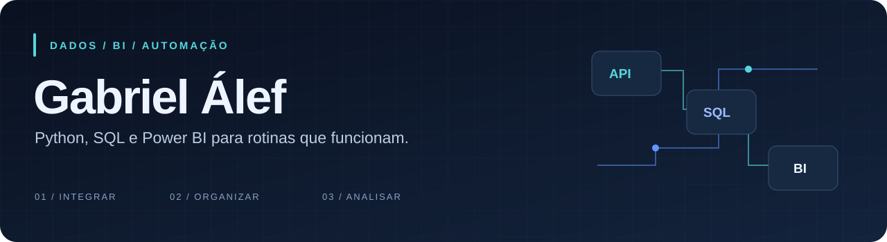
  </picture>

  
  
  

  <picture>
    <source media="(prefers-reduced-motion: reduce) and (max-width: 600px)" srcset="assets/typing-static-mobile.svg" />
    <source media="(prefers-reduced-motion: reduce)" srcset="assets/typing-static.svg" />
    <source media="(max-width: 600px)" srcset="assets/typing-mobile.svg" />
    
  </picture>

## Sobre mim

Sou **Gabriel Álef**, analista de dados e formado em Análise e Desenvolvimento de Sistemas.

Gosto de entender de onde vem o dado, conferir se ele faz sentido e tirar do caminho o trabalho que não precisa continuar manual. Minha experiência reúne **integração de sistemas, ETL, modelagem de dados e dashboards operacionais e financeiros**.

Uso **Python, SQL, PostgreSQL e Power BI** para conectar fontes, organizar bases e construir indicadores ligados à rotina do negócio. Já trabalhei com integrações envolvendo Gestta, Notion, Onvio e Conta Azul.

Este portfólio apresenta **como identifico problemas, organizo dados, escolho abordagens e comunico resultados**. Cada projeto conecta contexto, minha atuação, decisões técnicas e evidências para quem deseja conhecer meu trabalho.

Os casos de experiência profissional preservam o contexto e os resultados relatados; os estudos autorais usam dados fictícios. Demonstrações, testes e documentação permitem aprofundar a avaliação sem acesso a sistemas corporativos.

**Meu foco profissional:** Análise de Dados e BI, com interesse em Analytics Engineering pela combinação de SQL, modelagem, testes e confiabilidade dos dados.

## Tecnologias que uso nos projetos

As ferramentas abaixo aparecem nos projetos públicos e na experiência documentada. Estão organizadas por uso; a implantação da demonstração é apresentada como prática do projeto, sem equivaler a especialização em cloud.

**Dados, linguagens e bancos**

  
  
  
  
  
  
  
  
  
  

**Business Intelligence**

  
  
  
  

**Análise, modelagem e visualização**

  
  
  

**Integração e automação**

  
  
  
  
  
  

**IA, API e interface**

  
  
  
  
  
  
  
  
  
  
  

**Versionamento, testes e ambiente da demonstração**

  
  
  
  
  
  
  
  
  
  
  
  
  

**Integrações trabalhadas:** Gestta, Onvio, Notion, Conta Azul e Slack. Os exemplos públicos usam dados fictícios e serviços simulados quando dependem de contas corporativas.

**Outras ferramentas da experiência e formação:** MySQL, Power Platform e Google Sheets.

**Métodos e práticas:** ETL, APIs REST, OAuth2, modelagem relacional e dimensional, fatos e dimensões, KPIs, análise exploratória, KMeans, séries temporais, cargas transacionais, reconciliação, automação e testes.

## Projetos para conhecer meu trabalho

  <a href="https://github.com/GabrielTIAlef/gestao_geral"><picture><source media="(max-width: 600px)" srcset="assets/cards/gestao_geral-mobile.svg" />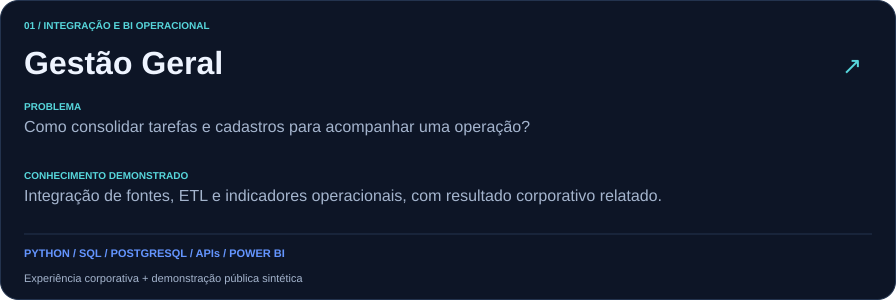</picture></a>

  <a href="https://github.com/GabrielTIAlef/agente_inteligencia_operacional"><picture><source media="(max-width: 600px)" srcset="assets/cards/agente_inteligencia_operacional-mobile.svg" />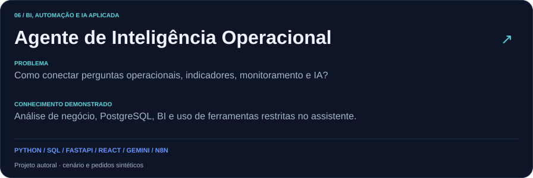</picture></a>

  <a href="https://github.com/GabrielTIAlef/DatAtlas"><picture><source media="(max-width: 600px)" srcset="assets/cards/datatlas-mobile.svg" />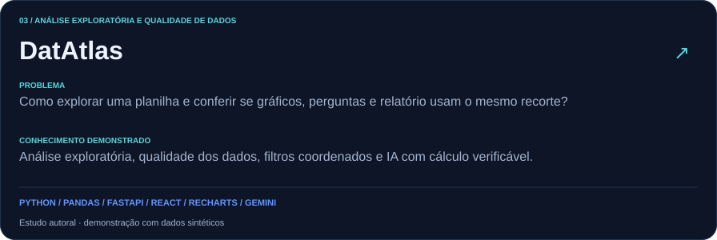</picture></a>

  <a href="https://github.com/GabrielTIAlef/gestao_financeira"><picture><source media="(max-width: 600px)" srcset="assets/cards/gestao_financeira-mobile.svg" />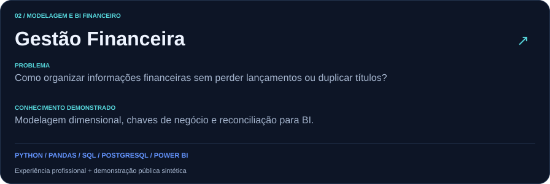</picture></a>

  <a href="https://github.com/GabrielTIAlef/automacao_financeira"><picture><source media="(max-width: 600px)" srcset="assets/cards/automacao_financeira-mobile.svg" />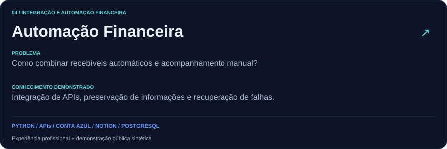</picture></a>

  <a href="https://github.com/GabrielTIAlef/analises_marketing"><picture><source media="(max-width: 600px)" srcset="assets/cards/analises_marketing-mobile.svg" />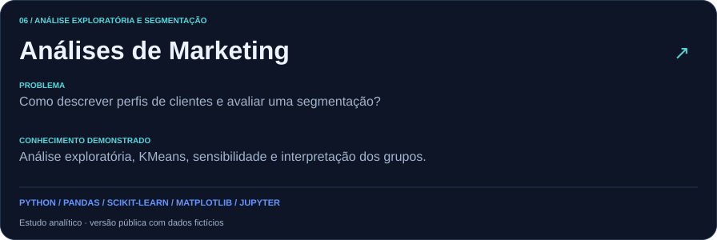</picture></a>

  <a href="https://github.com/GabrielTIAlef/bolsa_valores"><picture><source media="(max-width: 600px)" srcset="assets/cards/bolsa_valores-mobile.svg" />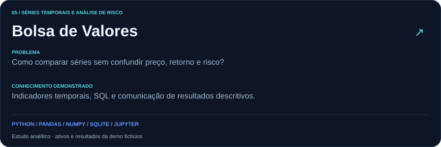</picture></a>

Os cards conectam problema, abordagem e competências; cada um abre o respectivo projeto. Os READMEs distinguem experiência original, implementação pública e resultados validados. As demonstrações usam dados fictícios.

## Resultados da experiência profissional

Na minha atuação com Dados e BI, os principais resultados e entregas registrados foram:

- **De cerca de cinco dias para cerca de cinco minutos:** automatizei uma rotina de consolidação e estruturação de dados. O [Gestão Geral](https://github.com/GabrielTIAlef/gestao_geral#resultados-observados-no-ambiente-corporativo) contextualiza esse resultado.
- **15 dashboards em Power BI, sendo seis gerenciais:** desenvolvi e mantive painéis para gestores e equipes acompanharem indicadores, produtividade, processos e desempenho.
- **Contribuição para redução aproximada de 70% da inadimplência:** estruturei análises históricas e segmentações que apoiaram estratégias de cobrança executadas em conjunto com as áreas envolvidas.
- **Desistências em níveis próximos de zero no novo fluxo de entrada:** analisei gargalos, retrabalhos e falhas de comunicação e apoiei a reestruturação do onboarding com indicadores e etapas de acompanhamento.
- **Quatro sistemas integrados em uma base analítica:** conectei Gestta, Onvio, Notion e Conta Azul, padronizando estruturas, identificadores e regras para uma visão consolidada.
- **Indicadores ligados à gestão:** construí análises de SLA, produtividade, tarefas, workflows, carteira de clientes, desempenho de equipes e resultados financeiros.
- **Melhor organização e desempenho da camada analítica:** modelei fatos e dimensões e migrei transformações de maior complexidade do Power BI para Python e PostgreSQL.
- **Experiência anterior no setor público:** nos estágios, apoiei tratamento de dados em Excel e painéis Power BI; no TRF1, também desenvolvi e ajustei páginas de internet/intranet com HTML, CSS, JavaScript e ferramentas da Power Platform.

Esses resultados pertencem à experiência profissional relatada nos meus materiais de carreira. Os efeitos sobre cobrança e entrada de clientes envolveram a atuação das equipes; não são impactos medidos nas demonstrações sintéticas do GitHub. Resultados qualitativos não têm percentuais adicionais atribuídos.

## Vamos conversar

Tenho interesse em oportunidades de **Dados e BI** em que eu possa trabalhar perto do negócio e também cuidar da qualidade das bases, das integrações e das automações.

[LinkedIn](https://www.linkedin.com/in/gabrielalef/) · [Portfólio](https://gabrieltialef.github.io/Portf-lio/) · [gabrielalefti@gmail.com](mailto:gabrielalefti@gmail.com)

<strong>Atividade no GitHub, estatísticas e marcos dos projetos</strong>

 

  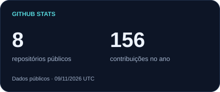
  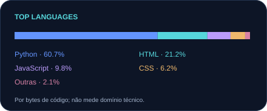

  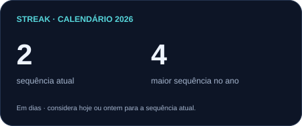
  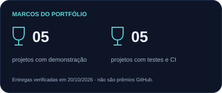

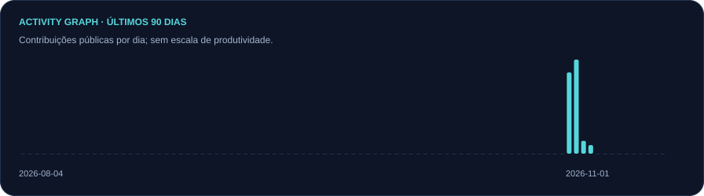

<picture><source media="(prefers-reduced-motion: reduce)" srcset="assets/metrics/snake-static.svg" />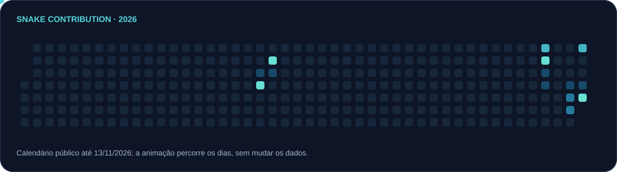</picture>

Os indicadores usam apenas dados públicos. Linguagens são contadas por bytes e sequências refletem atividade no GitHub, não produtividade ou experiência profissional. Os emblemas adaptam a ideia de GitHub Trophies para marcos verificáveis dos projetos; não representam prêmios da plataforma. [Fontes, atualização e critérios](docs/PERFIL.md).

 

<a href="https://www.linkedin.com/in/gabrielalef/"><picture><source media="(max-width: 600px)" srcset="assets/footer-mobile.svg" /></picture></a>
