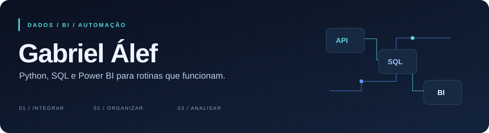
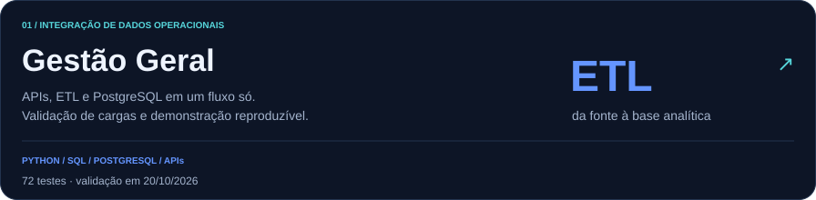
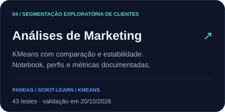
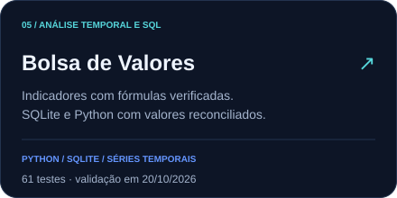
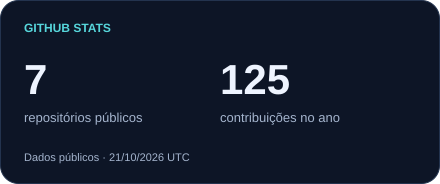
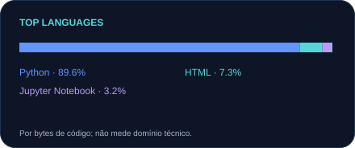
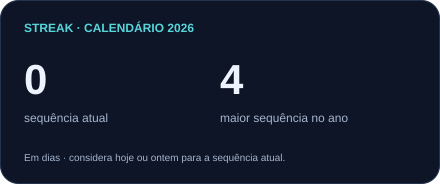
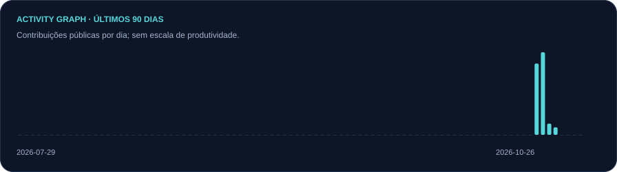
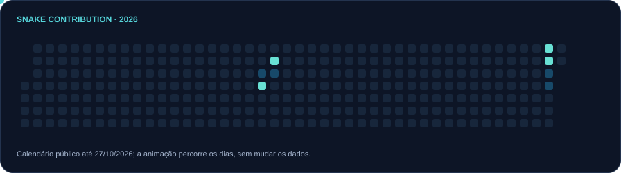

  <picture>
    <source media="(max-width: 600px)" srcset="assets/banner-mobile.svg" />
    
  </picture>

  
  
  

  <picture>
    <source media="(prefers-reduced-motion: reduce) and (max-width: 600px)" srcset="assets/typing-static-mobile.svg" />
    <source media="(prefers-reduced-motion: reduce)" srcset="assets/typing-static.svg" />
    <source media="(max-width: 600px)" srcset="assets/typing-mobile.svg" />
    
  </picture>

## Sobre mim

Sou **Gabriel Álef**, analista de dados e formado em Análise e Desenvolvimento de Sistemas.

Gosto de entender de onde vem o dado, conferir se ele faz sentido e tirar do caminho o trabalho que não precisa continuar manual. Minha experiência reúne **integração de sistemas, ETL, modelagem de dados e dashboards operacionais e financeiros**.

Uso **Python, SQL, PostgreSQL e Power BI** para conectar fontes, organizar bases e construir indicadores ligados à rotina do negócio. Já trabalhei com integrações envolvendo Gestta, Notion, Onvio e Conta Azul.

Nos projetos públicos, acrescentei dados fictícios, testes, documentação e validação automatizada. Assim, quem abre o repositório consegue executar uma demonstração e conferir o comportamento do código sem depender de sistemas corporativos.

**Meu foco profissional:** Análise de Dados e BI, com interesse em Analytics Engineering pela combinação de SQL, modelagem, testes e confiabilidade dos dados.

## Tecnologias que uso nos projetos

  
  
  
  
  
  
  
  
  

**Na prática:** APIs REST, DAX, Power Query, modelagem dimensional, cargas transacionais, reconciliação, automação e testes. As ferramentas aparecem nos projetos conforme a necessidade de cada problema.

## Projetos para conhecer meu trabalho

Comece pelo **Gestão Geral** para ver integrações e ETL. O **Gestão Financeira** concentra modelagem e cargas; o **Automação Financeira**, coordenação de processos e tratamento de falhas.

<a href="https://github.com/GabrielTIAlef/gestao_geral"><picture><source media="(max-width: 600px)" srcset="assets/cards/gestao_geral-mobile.svg" /></picture></a>

  
  

Também mantenho estudos de **segmentação de clientes e séries temporais**, com metodologia, exemplos fictícios e limites documentados:

  
  

Os cinco projetos têm demonstrações com **dados fictícios, testes automatizados e GitHub Actions**. Os READMEs distinguem experiência original, implementação pública e resultados efetivamente validados. Os testes não equivalem à homologação de sistemas corporativos ou à execução dos painéis no Power BI Desktop.

### Um resultado da experiência profissional

No projeto de gestão operacional, a atualização dos painéis passou de **cerca de cinco dias para menos de cinco minutos**, conforme meu relato de experiência registrado no [contexto do Gestão Geral](https://github.com/GabrielTIAlef/gestao_geral#resultados-observados-no-ambiente-corporativo). Esse resultado pertence ao ambiente corporativo original; não é um benchmark das demonstrações públicas.

## Vamos conversar

Tenho interesse em oportunidades de **Dados e BI** em que eu possa trabalhar perto do negócio e também cuidar da qualidade das bases, das integrações e das automações.

[LinkedIn](https://www.linkedin.com/in/gabrielalef/) · [Portfólio](https://gabrieltialef.github.io/Portf-lio/) · [gabrielalefti@gmail.com](mailto:gabrielalefti@gmail.com)

<strong>Atividade no GitHub, estatísticas e marcos dos projetos</strong>

 

  
  

  
  

<picture><source media="(prefers-reduced-motion: reduce)" srcset="assets/metrics/snake-static.svg" /></picture>

Os indicadores usam apenas dados públicos. Linguagens são contadas por bytes e sequências refletem atividade no GitHub, não produtividade ou experiência profissional. Os emblemas adaptam a ideia de GitHub Trophies para marcos verificáveis dos projetos; não representam prêmios da plataforma. [Fontes, atualização e critérios](docs/PERFIL.md).

 

<a href="https://www.linkedin.com/in/gabrielalef/"><picture><source media="(max-width: 600px)" srcset="assets/footer-mobile.svg" /></picture></a>
